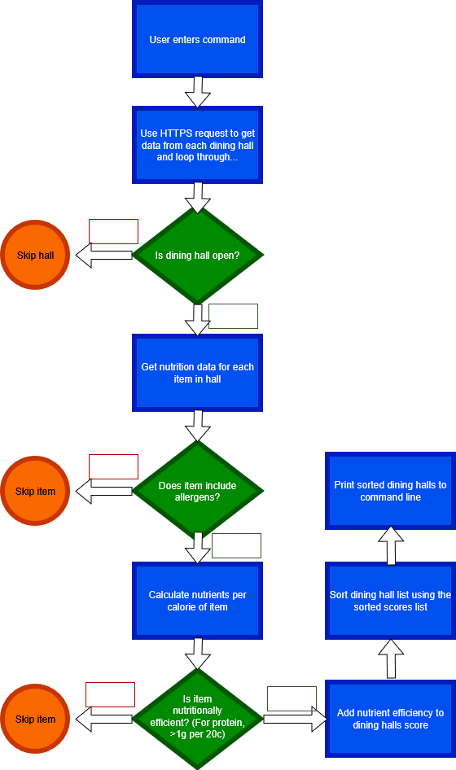

# PurduePlate

A Java command line tool that outputs the most nutrient-efficient meals at each dining hall.

## The Problem

I am trying to solve the problem of planning nutrient-dense meals at dining courts. Many people want to gain weight and muscle, but it is hard to know how much protein you get at the dining halls, and how to optimize your meal to get the most out of your plate.

## How It Works

- The program calls the purdue_api through HTTPClient to collect data about meals and their nutritional value.
- It ranks food items on a gram/calorie basis and attributes a score to each dining hall.
- Ranks Dining halls and most nutritious foods at the current time.

## Tech Stack

- **Language:** Java
- **External tools:** purdue_api

## Roadmap

Features you haven't built yet but plan to (pull these from your
"Schedule" quadrant in the Eisenhower Matrix).

- [ ] Multi-Day Meal Plans
- [ ] Diet and calorie deficit/surplus
- [ ] Meal Preferences (weighing against certain disliked foods)

## Author

Nolan Andreuzzi, https://github.com/NolanAndreuzzi